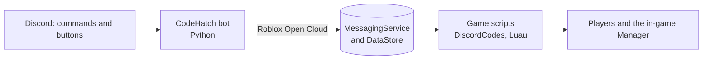

# CodeHatch: run your Roblox game from Discord

CodeHatch is a Discord bot (Python, discord.py) that controls a live Roblox game through **Roblox Open Cloud**. You type a command or click a button on Discord, and the change reaches your game within seconds: promo codes, multiplier events, eggs, gifts, on-screen announcements, bans and player cards. A set of Luau scripts in the game receives the changes, and an in-game **⚙️ Manager** window lets the game's owner do the same without the bot. The bot speaks English, Polish and Spanish.

Free and open source under the MIT license.

## Features

- **Promo codes:** `/code-add`, `/code-remove`, `/codes`, `/sync-codes`. Rewards: a currency, EXP or an item/pet from the game's catalog.
- **Events and multipliers:** `/event-start`, `/event-stop`, `/events`. For example 2x Coins or more luck for rare pets, on every server at once.
- **Eggs:** `/egg-create`, `/egg-edit`, `/egg-remove`, `/eggs`. A paid random egg on a stand in the game, with the exact chances shown (as Roblox requires for paid random items).
- **Gifts:** `/give` sends a reward to a player; it is delivered in the game.
- **Announcements:** `/announce-game` shows a message in the game.
- **Bans:** `/roblox-ban`, `/roblox-unban`, `/roblox-ban-check`.
- **Leaderboard:** `/leaderboard`, `/leaderboard-setup`.
- **Player cards:** look up a player by name or ID from `/setup-roblox`.
- **In-game ⚙️ Manager:** a window in the game for codes, events, eggs, gifts and players, working even when the bot is off.
- **Guided setup:** `/setup` (the Discord side), `/setup-roblox` (the game side), `/setup-guide` and `/tutorial` (step-by-step help for beginners), plus a `DOCS.html` documentation page that the bot generates.
- **Safety:** an action log channel and automatic database backups.

## How it works



The bot never runs inside Roblox. It writes data (codes, eggs, events, gifts) to DataStores and sends live messages through MessagingService. The scripts in the game read them and apply the changes. If the bot is off, the game keeps working with the last saved data.

## Quick start

You need Python 3.12–3.14, a Discord server where you are an administrator, and a Roblox game you can edit in Roblox Studio and create an Open Cloud API key for.

1. Clone the repository (`git clone`) or click **Code** → **Download ZIP** on GitHub and extract it.
2. Run `start.bat` (Windows) or `bash start.sh` (Linux/macOS). The script creates the virtual environment, installs the libraries and creates `.env` for you, then stops.
3. Open `.env` and set:
   - `DISCORD_TOKEN`: the bot token from the Discord Developer Portal,
   - `ROBLOX_API_KEY`: an Open Cloud API key from the Roblox Creator Hub (you can also leave it empty and paste it on Discord in `/setup-roblox`).
4. Run `start.bat` / `bash start.sh` again. Invite the bot to your server, and on Discord:
   1. Type `/setup` and set up the Discord side (channels, who may use the bot, language).
   2. Type `/setup-roblox` and connect the game (the “Roblox game” step asks for your game link).
   3. Put the Studio file in your game. `scripts/DiscordCodes.rbxmx` is already in the repository: in Roblox Studio right-click **ServerScriptService** → **Insert** → **Import Roblox Model** and pick it. Run `python tools/build_roblox_kit.py` only if you change the `.luau` sources in `scripts/DiscordCodes/`.
   4. Type `/tutorial` for the guided first steps.

Never share `.env`: it holds your secrets and is not stored in git.

Manual setup (developers), instead of the start scripts:

```bash
# Windows
python -m venv .venv
.venv\Scripts\pip install -r requirements.txt
copy .env.example .env
.venv\Scripts\python main.py

# Linux / macOS
python3 -m venv .venv
.venv/bin/pip install -r requirements.txt
cp .env.example .env
.venv/bin/python main.py
```

## Tests

Run the suite with `python -m unittest discover tests` inside the venv. There are 750 tests; about 181 of them are skipped unless the `lupa` package is installed (they run the Luau game scripts in a Lua sandbox).

## Documentation for beginners

A detailed, step-by-step guide that assumes you have never set up a bot:

| Language | Guide |
|---|---|
| English | [README_EN.md](README_EN.md) |
| Polski | [README_PL.md](README_PL.md) |
| Español | [README_ES.md](README_ES.md) |

`DOCS.html` does not exist in the repository: the bot writes it in its folder at the first start. It is the same documentation as a searchable page with step-by-step missions.

## Project status

Finished, not actively maintained. Issues are welcome.

## License

MIT, see [LICENSE](LICENSE). Copyright (c) 2026 Gordiv.
